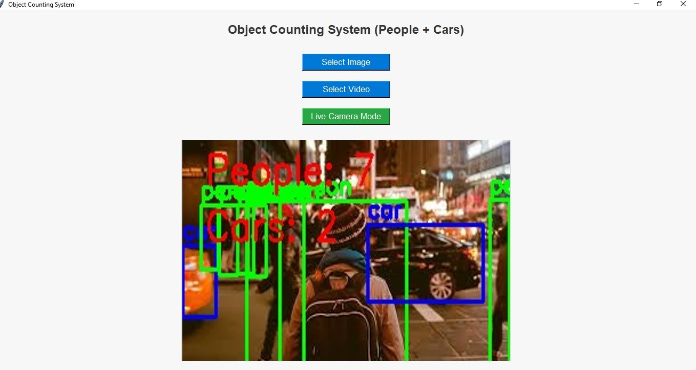
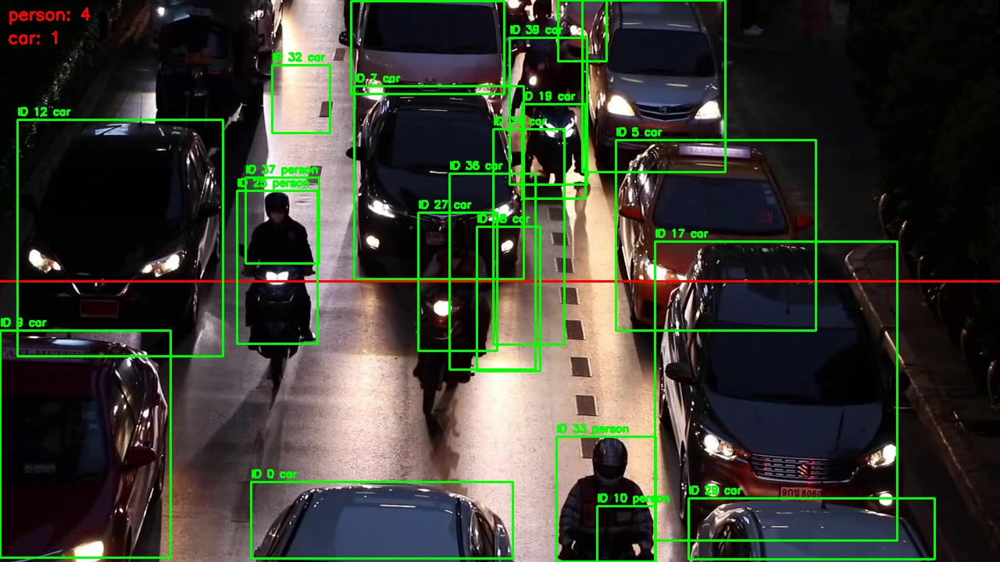

# 🚦 Object Counting System (People + Cars) using YOLOv8

A computer vision project that detects and counts **people** and **cars** in images, recorded videos and live camera feeds, using YOLOv8, OpenCV and a Tkinter desktop interface.

Developed as a course project for the Artificial Intelligence course at Corvit, Rawalpindi (Instructor: Engineer Aamir Jamil), October 2025.

---

## ✨ Features
- Detects people and cars with a pretrained **YOLOv8n** model
- Counts objects in **images**, **videos** and **live camera mode**
- Tracks objects across video frames with a **centroid tracker** and assigns each a unique ID
- Counts objects when they **cross a virtual line**, so the same object is not counted twice
- Draws bounding boxes, labels and running counts, and saves the output image or video
- Simple **Tkinter GUI**: Select Image, Select Video, Live Camera Mode

## 🖼️ Demo

**Desktop application (image mode)**



**Video mode: tracked objects with IDs and the counting line (red)**



## ⚙️ How It Works
1. Load the pretrained YOLOv8 model (Ultralytics).
2. Read the image, video frame or camera frame with OpenCV.
3. Detect objects and keep only the `person` and `car` classes (confidence ≥ 0.4).
4. Track detections between frames with a centroid tracker (nearest-centroid matching with a maximum distance).
5. When a tracked object's centre crosses the counting line, add it to its class count (each object is counted once).
6. Draw boxes, IDs and counts on the frame, then save the result.

## 📊 Results
| Input | Result |
|---|---|
| Sample street image | 7 people, 2 cars detected |
| Sample traffic video (about 23 s) | 14 people and 10 cars counted crossing the line |

Video counts are **line-crossing counts** (objects that crossed the red line), not the total number of objects visible in the video.
These are demonstration results on sample inputs, not a benchmark. No accuracy evaluation against ground truth was performed.

## 🚀 Getting Started

**1. Clone the repository**
```bash
git clone https://github.com/anashahid01-web/object-counting-system.git
cd object-counting-system
```

**2. Install the requirements** (Python 3.9 or newer; Tkinter comes with Python)
```bash
pip install -r requirements.txt
```

**3. Run the notebook**
```bash
jupyter notebook object_counting_system.ipynb
```
The YOLOv8n weights (`yolov8n.pt`) are downloaded automatically by Ultralytics the first time you run it.

Put your own files in these folders, or change the paths in the notebook:
- video: `video/myvideo.mp4`
- image: `image/your_image.jpg`

## 📁 Project Structure
```
object-counting-system/
├── README.md
├── requirements.txt
├── .gitignore
├── object_counting_system.ipynb   # detection, tracking and counting
├── app.py                         # Tkinter GUI (image / video / live camera)
└── assets/
    ├── gui_screenshot.jpg
    └── video_demo_frame.jpg
```

## 🛠️ Tech Stack
Python · YOLOv8 (Ultralytics) · OpenCV · NumPy · SciPy · Matplotlib · Tkinter · Jupyter Notebook

## ⚠️ Limitations and Future Work
- The simple centroid tracker can swap IDs when objects overlap or are hidden (for example in dense traffic). A stronger tracker such as ByteTrack or DeepSORT would improve this.
- YOLOv8n is the smallest YOLOv8 model, chosen for speed. A larger model would be more accurate but slower.
- Possible extensions: more object classes, multiple counting lines with direction (in/out), saving counts to a CSV file, and IoT or smart-city integration.

## 🙏 Acknowledgements
- [Ultralytics YOLOv8](https://docs.ultralytics.com) (AGPL-3.0 licence)
- [OpenCV](https://opencv.org)

## 👩‍💻 Author
**Ana Shahid**
